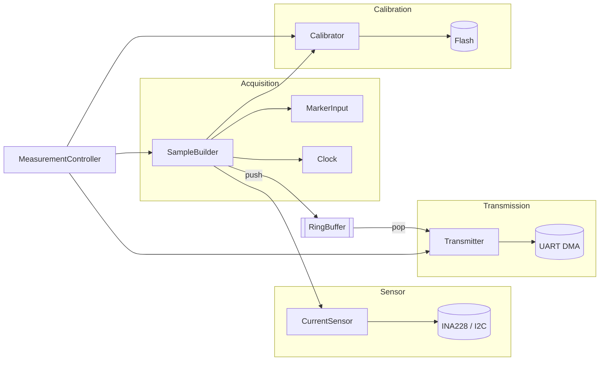
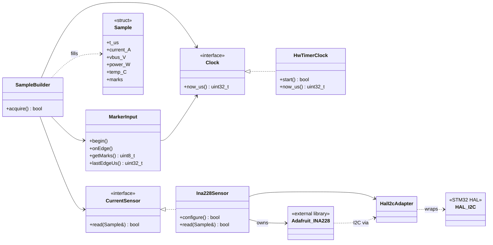
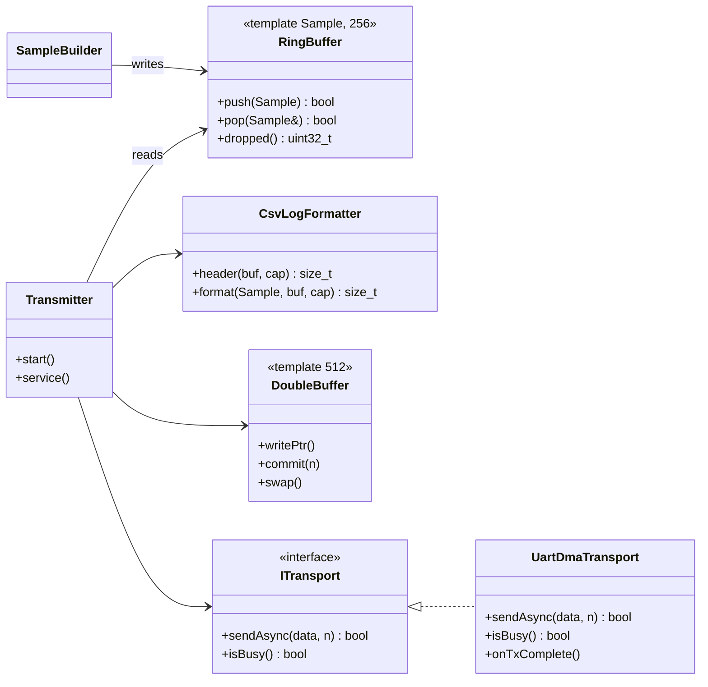
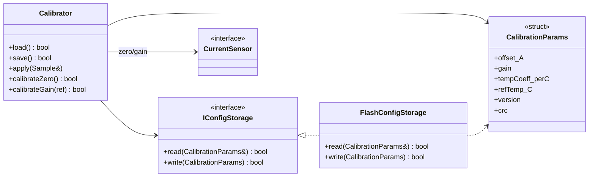
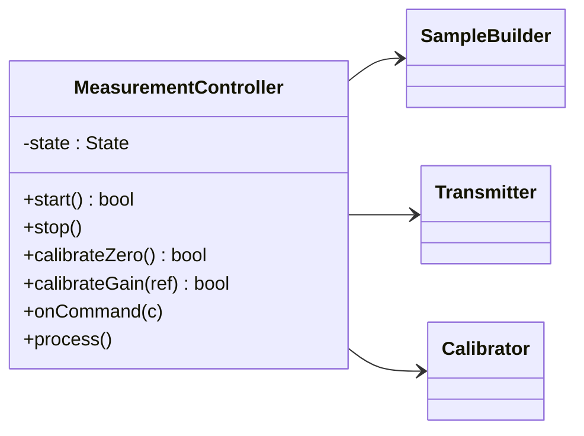

# Architecture

## Description

The firmware runs on an STM32F302 microcontroller. It measures the power consumption of a device under test with an INA228 power monitor (I2C) and streams timestamped samples as CSV over UART (DMA) through the ST-LINK virtual COM port to a PC for analysis.

The code is split into five parts. Every hardware dependency sits behind an interface (`CurrentSensor`, `Clock`, `ITransport`, `IConfigStorage`), so the logic does not depend on the STM32 HAL or on a specific sensor library.

### Data flow

1. `SampleBuilder` is the producer. On each `acquire()` it reads the sensor, takes a timestamp from `Clock`, adds the GPIO marks from `MarkerInput` and applies calibration through `Calibrator`. The result is a `Sample`: `t_us`, `current_A`, `vbus_V`, `power_W`, `temp_C`, `marks`.
2. The sample is pushed into `RingBuffer` (256 samples). The buffer decouples the fixed-rate acquisition from the slower, asynchronous transmission. If the consumer falls behind, the push fails and the `dropped()` counter increases, so data loss is visible and not silent.
3. `Transmitter` is the consumer. In `service()` it pops samples from the ring buffer and formats them as CSV lines with `CsvLogFormatter` (`header()` for the column names, `format()` for each sample). The lines are written into `DoubleBuffer` (512 bytes per half).
4. While one half of the `DoubleBuffer` is being sent, the other is being filled. When a half is full, `swap()` exchanges them and `ITransport::sendAsync()` starts the transfer of the filled half. `UartDmaTransport` implements it with UART DMA, so the CPU does not wait for the transmission. `onTxComplete()` is called from the DMA-complete interrupt and frees the transport for the next block.

### Components

**Application**
- `MeasurementController` is the only entry point for control. It owns the state machine (`state`), handles host commands in `onCommand()` and runs `process()` from the main loop. It provides `start()`, `stop()`, `calibrateZero()` and `calibrateGain(ref)`, and delegates the work to `SampleBuilder`, `Transmitter` and `Calibrator`.

**Acquisition**
- `SampleBuilder` assembles one `Sample` per acquisition cycle.
- `Clock` is a time-source interface. `HwTimerClock` implements it with a free-running hardware timer and returns microseconds from `now_us()`. All timestamps use this clock, so samples and marks share one time base.
- `MarkerInput` handles the external GPIO marker lines. `onEdge()` runs in the pin interrupt and records the edge time (`lastEdgeUs()`); `getMarks()` returns the current marker bits that are put into `Sample.marks`. This lets a user correlate the current waveform with events in the device under test.

**Sensor**
- `CurrentSensor` is the sensor interface: `read(Sample&)` fills the measured fields.
- `Ina228Sensor` implements it on top of the external Adafruit INA228 library, which it owns. `configure()` sets up the INA228 registers.
- The library needs an I2C interface, which is provided by `HalI2cAdapter`. It wraps the STM32 `HAL_I2C` functions, so the third-party library is used without changes.

**Transmission**
- `RingBuffer`, `Transmitter`, `CsvLogFormatter`, `DoubleBuffer`, `ITransport` and `UartDmaTransport` form the output path described above. Replacing UART with another transport (for example USB CDC) only requires a new `ITransport` implementation.

**Calibration**
- `Calibrator` corrects raw readings in `apply()`. The parameters are in `CalibrationParams`: `offset_A` (zero offset), `gain`, `tempCoeff_perC` with `refTemp_C` (temperature compensation), `version` and `crc`.
- `calibrateZero()` measures the offset with no load, and `calibrateGain(ref)` computes the gain from a known reference current. Both use `CurrentSensor` for the measurement.
- `load()` and `save()` persist the parameters through `IConfigStorage`. `FlashConfigStorage` stores them in MCU flash, so calibration survives power cycles. The `version` and `crc` fields allow invalid or outdated data to be detected and defaults to be used instead.

### Design decisions

- **Interfaces at hardware boundaries.** Sensor, clock, transport and storage can be replaced or mocked, so the logic can be tested without the hardware.
- **Producer/consumer with a ring buffer.** Sampling timing does not depend on UART speed, and overflow is counted.
- **Double buffering with DMA.** Formatting and transmission run in parallel without blocking the main loop.
- **Single time base.** One hardware timer provides timestamps for both samples and GPIO marks.
- **Calibration kept apart from acquisition.** Raw measurement, correction and persistence are separate responsibilities.

## Overview diagram

## Class diagram: Acquisition and Sensor

## Class diagram: Transmission

## Class diagram: Calibration

## Class diagram: Application

